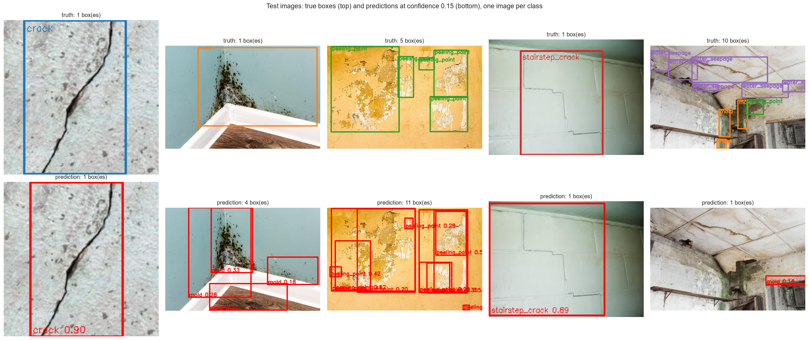
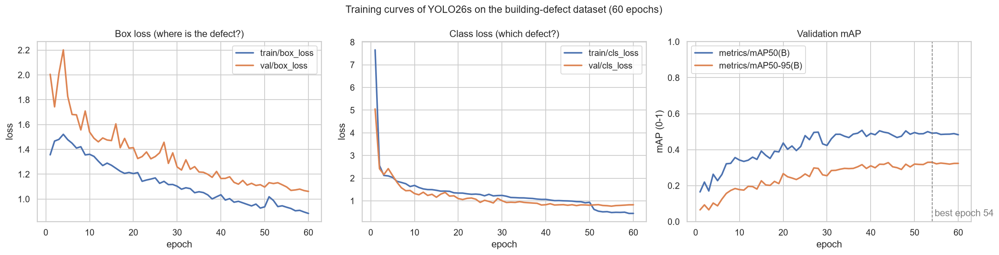
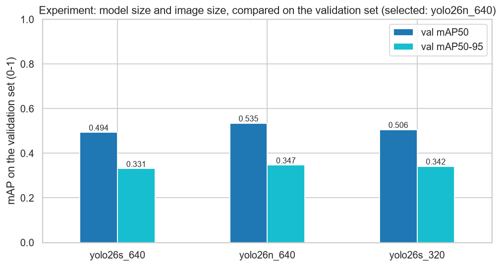
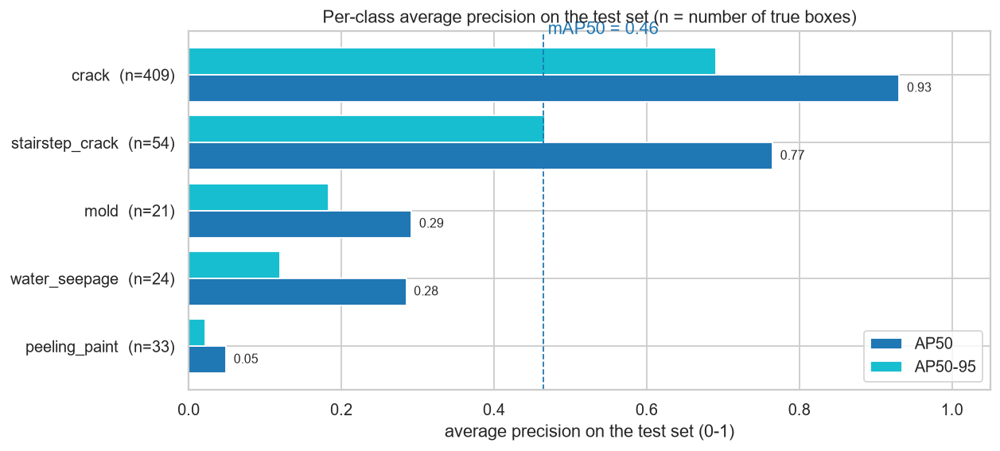
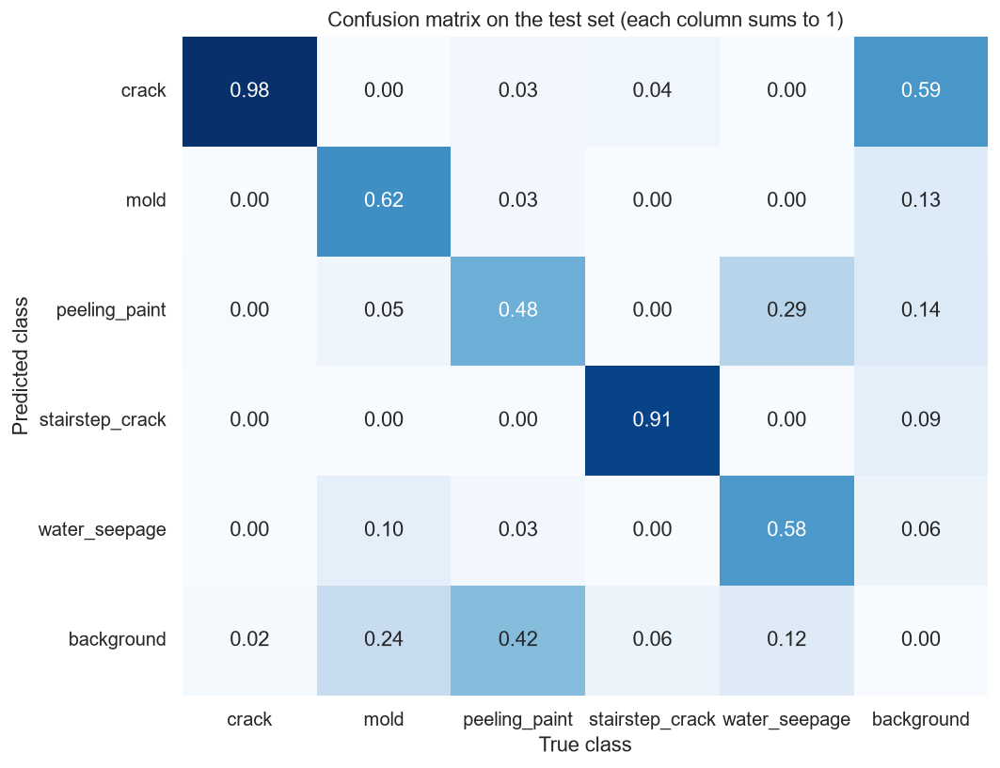
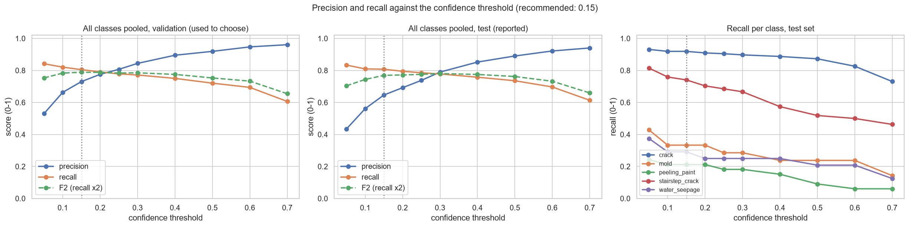
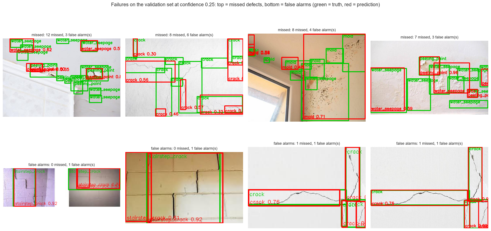
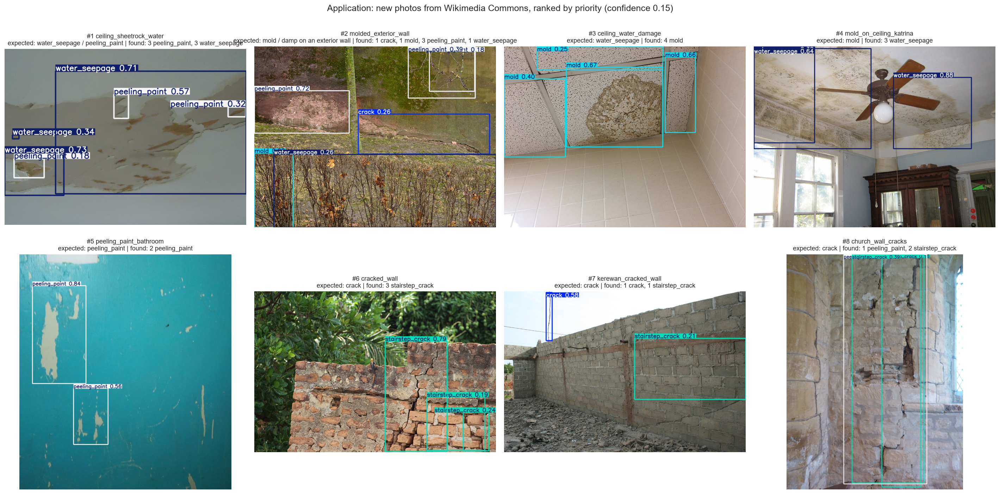
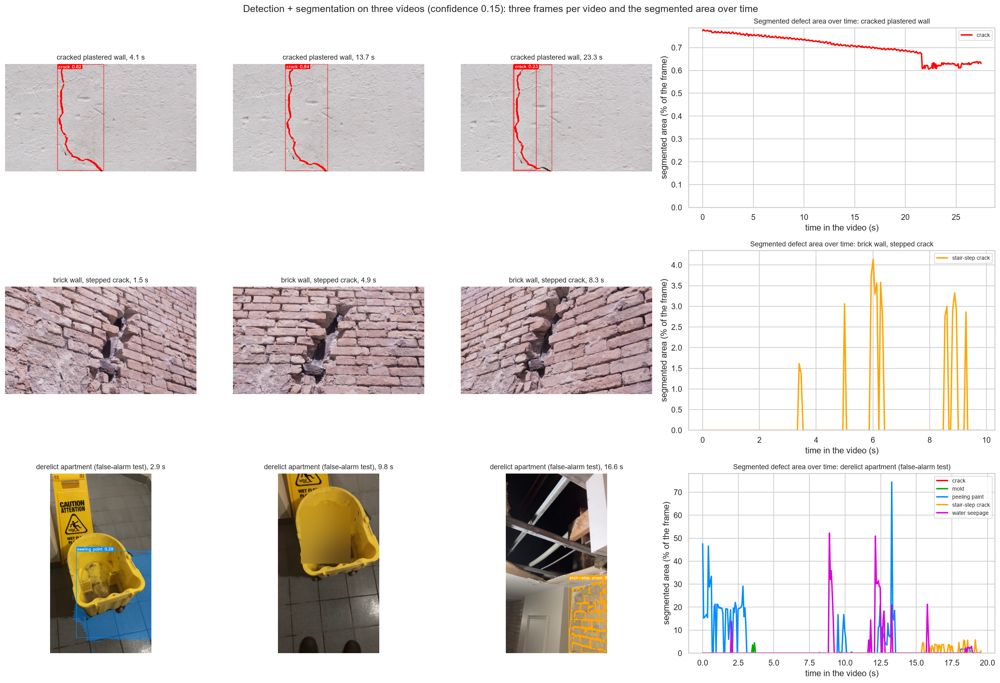
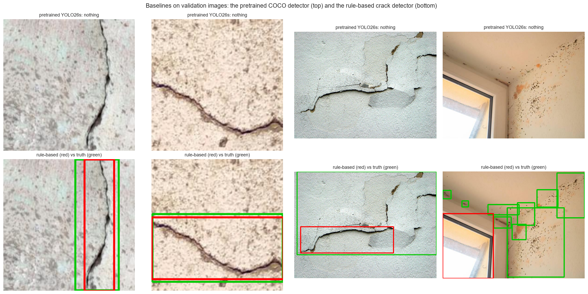

# Building defect detector: cracks, mold, peeling paint and water damage in inspection photos and videos

**Team:** Amelia, Jerome, Kazuko, Sahil (team 1)
**Course:** AI Methods I – Day 4: Neural networks and computer vision (IAAC MaAI 2026/27)
**Track:** B (detection / segmentation): a YOLO26 detector fine-tuned on an openly licensed dataset, combined with SAM for segmentation masks
**Model on Hugging Face:** https://huggingface.co/iaac-maai/day4-team1-building-defect-detector


*Test images the model never saw during training: true boxes on top, predictions below (confidence ≥ 0.15). Cracks and stair-step cracks are found exactly; mold and peeling paint are found but split into more boxes than the labels; in the room on the right, 10 water-seepage boxes are missed and only one patch of mold is found.*

## Use case

A building surveyor, facade inspector or facility manager comes back from a condition survey with **hundreds of photos or a walk-through video** of walls and ceilings. Our model **pre-screens** them: it marks cracks, stair-step cracks in masonry, mold, peeling paint and water seepage, and ranks the photos (or the moments of a video) to check first. A **missed defect** is the expensive mistake (a growing crack or a leak that nobody looks at), while a false alarm only costs a few seconds of a person's time. We therefore favour **recall** and recommend a low confidence threshold (0.15). A person always confirms: the model is not a structural assessment.

This continues our [Day 2 project](https://github.com/iaac-maai/group1_day2_assignment), which ranked New York buildings by the risk of an UNSAFE facade inspection: Day 2 says **which buildings** to inspect, Day 4 helps with **what is wrong** in the inspection photos.

## Dataset

| | |
|---|---|
| **Name** | *detr_crack_dataset* (Roboflow Universe), mirrored on Hugging Face as [`senthilsk/crack_detection_dataset`](https://huggingface.co/datasets/senthilsk/crack_detection_dataset) |
| **Source** | [universe.roboflow.com/objectdetection-qxiqx/detr_crack_dataset](https://universe.roboflow.com/objectdetection-qxiqx/detr_crack_dataset) |
| **Size** | 2,950 images, 3,708 boxes, 5 classes: `crack` (2,805 boxes), `stairstep_crack` (311), `peeling_paint` (309), `water_seepage` (149), `mold` (134) |
| **Our split** | 70 / 15 / 15 % **by source** (same original photo or near-identical image → same split), stratified by the rarest class: 2,060 train / 444 validation / 446 test images. The original split had no `stairstep_crack` in its test set. |
| **Licence** | CC BY 4.0 |

About 80 % of the images are 200 × 200 px close-ups of a single crack; the other classes come from a few hundred larger web photos of walls and ceilings (some with stock-photo watermarks). The data is downloaded by the notebook, not committed.

**Media used only to apply the model** (not for training or scoring): 8 photos from Wikimedia Commons and 3 videos (two from [Pexels](https://www.pexels.com/license/), one from Wikimedia Commons); authors and licences are listed in section 7 of the notebook.

## Repository structure

```
├── data/                 # downloaded by the notebook (dataset, new photos, videos, pretrained weights): not committed
├── figures/              # the 13 figures exported by the notebook
├── models/
│   ├── README.md         # the Hugging Face model card
│   ├── *.png             # the figures shown in the model card
│   ├── results.csv       # training log of the published model (one row per epoch)
│   ├── experiments.csv   # the experiment of section 5 (3 runs compared on validation)
│   ├── model.pt          # the trained weights: on Hugging Face only
│   └── video_*.mp4       # the 3 annotated videos: on Hugging Face only
├── notebook/
│   └── object_detection.ipynb   # the whole pipeline, with outputs
├── .gitignore
├── LICENSE
├── README.md
└── requirements.txt
```

## How to run

```bash
python -m venv .venv
.venv\Scripts\activate             # macOS / Linux: source .venv/bin/activate
pip install torch==2.14.1 torchvision==0.29.1 --index-url https://download.pytorch.org/whl/cu130   # NVIDIA GPU
# or, without a GPU: pip install torch==2.14.1 torchvision==0.29.1 --index-url https://download.pytorch.org/whl/cpu
pip install -r requirements.txt
```

Open `notebook/object_detection.ipynb`, select the `.venv` kernel and run all cells. The notebook downloads the dataset (46 MB), the pretrained YOLO26 and MobileSAM weights, 8 photos and 3 videos.

- **Where the training ran:** locally, on a laptop **NVIDIA RTX 5080 (16 GB)**. The three training runs took **24.5 min** (YOLO26s, 640 px), **11.7 min** (YOLO26n, 640 px) and **7.3 min** (YOLO26s, 320 px). A full run of the notebook with trained models takes about 15 minutes.
- **Without a GPU:** `TRAIN` is set to `False` automatically, and the notebook downloads our published weights and training logs from Hugging Face instead of training. The model predicts in about 30 ms per image on our laptop CPU (AMD Ryzen AI 9 HX 375, a recent high-end processor; older CPUs will be slower).

## Approach

1. **Data:** COCO labels converted to the YOLO format; our own **split by source** (file names + an 8 × 8 average hash for near-duplicates); written **class definitions**; a **privacy check** with the YuNet face detector of notebook 02 (6 of 2,950 images contain a face; every figure and video frame is blurred where a face is found).
2. **Baselines:** the pretrained YOLO26s (COCO, no defect class) and a **rule-based crack detector** (black-hat filter + Otsu threshold, notebook 02).
3. **Model:** YOLO26 pretrained on COCO, fine-tuned for 60 epochs (batch 32, early-stopping patience 20, seed 42, Ultralytics default optimiser and augmentation); the weights of the best validation epoch are kept.
4. **Experiment (section 5):** one change at a time, compared on the validation set: **model size** (YOLO26s, 10 M parameters, vs YOLO26n, 2.5 M) and **image size** (640 vs 320 px). The selected model is **YOLO26n at 640 px**.
5. **Test set, once:** mAP per class, confusion matrix, comparison with the baselines, and a **confidence threshold** chosen on validation (maximum F2: recall counts twice).
6. **Application:** a ranked inspection report for 8 new photos, and **3 videos with segmentation masks**: crack lines traced with the black-hat filter inside the YOLO boxes, surface defects (mold, peeling paint, water seepage) outlined by **MobileSAM** prompted with the YOLO boxes.

## Results

**Test set** (446 images, used once):

| Model | Crack precision | Crack recall | Recall, all classes | mAP50, all classes |
|---|---|---|---|---|
| Pretrained YOLO26s (COCO, no fine-tuning) | 0.00 | 0.00 | 0.00 | 0.00 |
| Rule-based crack detector (OpenCV) | 0.41 | 0.45 | 0.34 | – |
| **Our YOLO26n** (confidence 0.15) | **0.71** | **0.92** | **0.81** | **0.46** |

| Class | Test boxes | Precision | Recall | AP50 | AP50-95 |
|---|---|---|---|---|---|
| crack | 409 | 0.83 | 0.92 | **0.93** | 0.69 |
| stairstep_crack | 54 | 0.78 | 0.70 | **0.77** | 0.47 |
| mold | 21 | 0.46 | 0.29 | 0.29 | 0.18 |
| water_seepage | 24 | 0.41 | 0.25 | 0.28 | 0.12 |
| peeling_paint | 33 | 0.15 | 0.12 | 0.05 | 0.02 |
| **all** | 541 | 0.52 | 0.46 | **0.46** | **0.30** |

*(Per-class precision and recall in this table are Ultralytics' values at its own best-F1 confidence; the first table uses our threshold of 0.15.)*

### How it was trained


*The validation mAP50 rises from 0.17 after one epoch to about 0.48–0.50 from epoch 40 and then levels off; validation losses keep falling with the training losses, so there is no real overfitting. The limit is the data, not the training time.*


*The 4× smaller YOLO26n is slightly better on validation (mAP50-95 0.347 vs 0.331) and twice as fast to train; 320 px images are as good as 640 px. With about 2,000 mostly small images, model and image size barely matter: the data does.*

### How well it performs


*Two groups: line defects (crack 0.93, stair-step crack 0.77) are reliable; surface defects (mold 0.29, water seepage 0.28, peeling paint 0.05) are not. The rare classes have only 21–33 test boxes, so their scores are uncertain by about ±0.1.*


*Each column is a true class. Cracks are found 98 % of the time; 42 % of the peeling paint is missed (bottom row), and 29 % of the water seepage is called peeling paint. Most false alarms (right column) are `crack`, the most frequent class.*


*Chosen on validation, checked on test: at 0.15 the model finds 81 % of all defects with 65 % of its boxes correct. For mold, water seepage and peeling paint no threshold gives a good recall: only more and better-labelled data will help.*


*Top: the most missed defects; bottom: false alarms (green = truth, red = prediction). Many errors come from **box granularity**: the annotators drew many small boxes on stains and crack networks where the model draws a few large ones, or the reverse. Under the IoU ≥ 0.5 rule this counts as misses plus false alarms, although a person would call many of these predictions correct.*

### What it does


*Eight new photos from Wikimedia Commons, ranked by the sum of the detection confidences. Damage is found in all eight, and the most damaged rooms come first, but the defect type is often wrong: cracks in masonry are always called `stairstep_crack`, and the mold on the Katrina ceiling (#4) is called `water_seepage`.*


*Three videos with detection + segmentation (crack lines in red, surface masks from SAM). Cracked plaster: the crack is found in 100 % of the frames and traced exactly. Brick wall: the damage is recognised in only 10 % of the frames. Derelict apartment (a false-alarm test): low-confidence false alarms, e.g. the water in a mop bucket taken for peeling paint.*

The three annotated videos (with masks and labels) play on the [model page](https://huggingface.co/iaac-maai/day4-team1-building-defect-detector): `video_crack_white_wall.mp4`, `video_brick_wall_step_crack.mp4`, `video_derelict_apartment.mp4`.


*The baselines: the pretrained COCO model finds nothing; the rule-based detector boxes simple cracks but also a window frame (a dark straight edge).*

## Limitations

- **Surface defects are unreliable** (AP50 0.05–0.29): few examples, overlapping definitions (water causes stains, then mold and peeling paint) and inconsistent box sizes in the labels.
- **Data bias:** about 80 % of the images are close-ups of single cracks on plain walls; facades, other materials, climates and building types are under-represented, and almost every image contains a defect, so the model has seen little intact wall. On scenes unlike the training data it raises false alarms.
- **Masonry cracks** are almost always called `stairstep_crack`, whatever their shape.
- **Small test sets** for the rare classes (21–54 boxes): scores uncertain by about ±0.1. The split by source relies on file names and an image hash, so very similar crops of one photo could still be in different splits.
- **Web-sourced images:** the dataset is CC BY 4.0, but some images carry watermarks of stock-photo and inspection websites.
- **Not for:** structural safety assessments, decisions about a property (legal, insurance, sale) without a qualified person checking every result, or monitoring people. "No detection" means "not found", never "no defect".

## AI usage disclosure

We used **Claude Code** (Anthropic) as a coding **agent** in VS Code. **We did not write the code ourselves:** we defined the project, told the agent what to do at each step, and validated the results; the agent wrote and ran the code.

| | |
|---|---|
| **What we did** | **Defined the project:** we chose Track B, the theme (**building defects**, continuing our Day 2 facade-safety project), the dataset and the project name, from the options the agent found for us, and told the agent to train the model on that dataset. **Validated the model on videos:** we asked for the model to be applied to **videos**, with **segmentation masks** and the defect names on screen, and we watched the annotated videos to judge where it works (cracks) and where it fails (masonry damage, false alarms on a mop bucket). **Directed the application:** we kept the false-alarm test video, and rejected and replaced one of the application photos. **Checked the texts:** we review and correct the readings, the README and the model card before submitting. |
| **What the agent did** | Read the brief and the class notebooks; searched for datasets, photos and videos and checked their licences; wrote and ran the notebook (data preparation, split by source, baselines, training on our GPU, evaluation, threshold sweep, photo report, video segmentation); produced the figures; drafted the readings, this README and the model card from the notebook outputs. |
| **Why** | To build a complete, reproducible pipeline within the time available, and to use the time saved on code to understand and question the method. |
| **How** | Through instructions in a chat with the agent, step by step, reviewing each result before moving on. |

**Lessons learned:**
- **Asking to *see* things improves the work.** Asking for segmentation on the video revealed that SAM outlines the wall next to a crack rather than the crack itself, which led to the crack-line tracer; asking for video revealed the false alarms on a mop bucket. The agent also found on its own that the dataset's original test set had no stair-step cracks.
- **Check real outputs, not summaries.** One run was first reported as successful although it had stopped at a download blocked by Wikimedia's rate limit; it was caught by checking which figures actually existed.
- **The understanding has to be ours.** The agent writes code fast, but we have to be able to explain every choice and every number, so we asked for explanations at each step and are responsible for every statement in this repository.

## License

Code released under the [MIT License](LICENSE). The model is released under **AGPL-3.0** (it is fine-tuned from Ultralytics YOLO26, see the model card). The dataset is CC BY 4.0 (see above); the photos and videos used in section 7 keep their own licences (CC BY, CC BY-SA, CC0, public domain and the Pexels licence), listed in the notebook.
